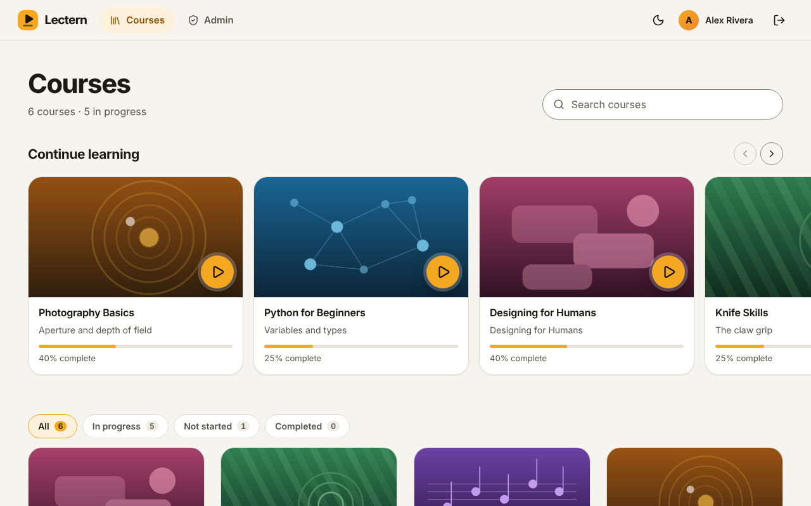
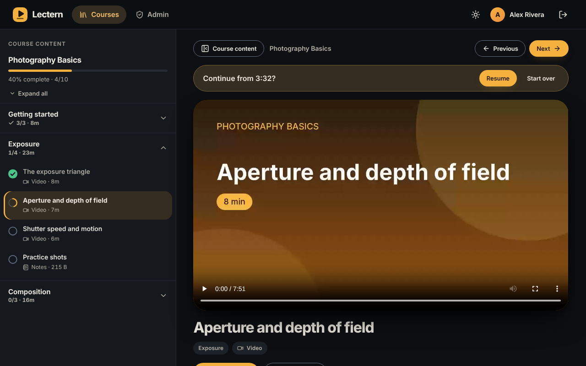
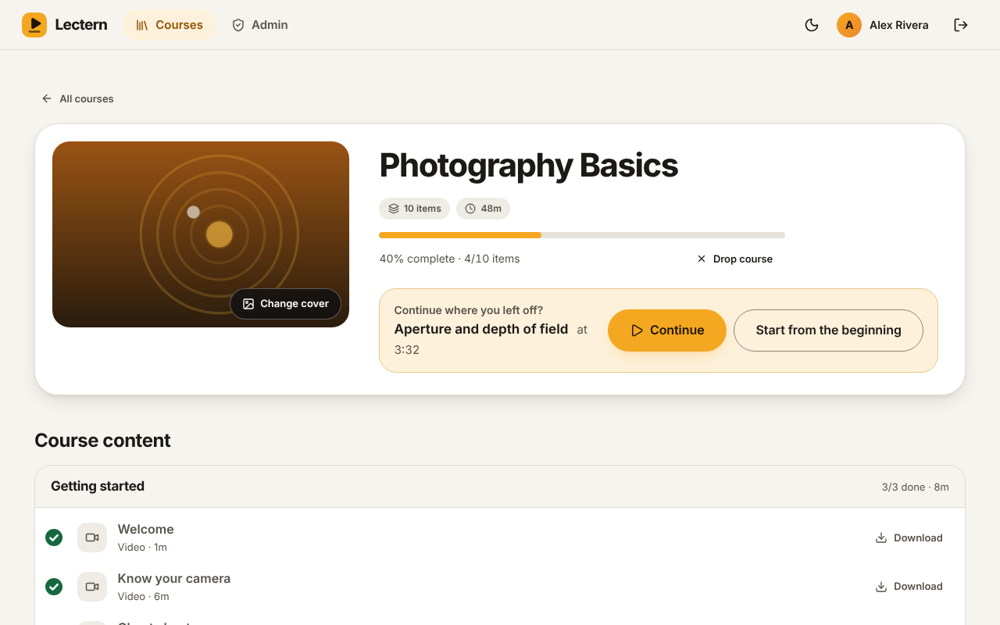
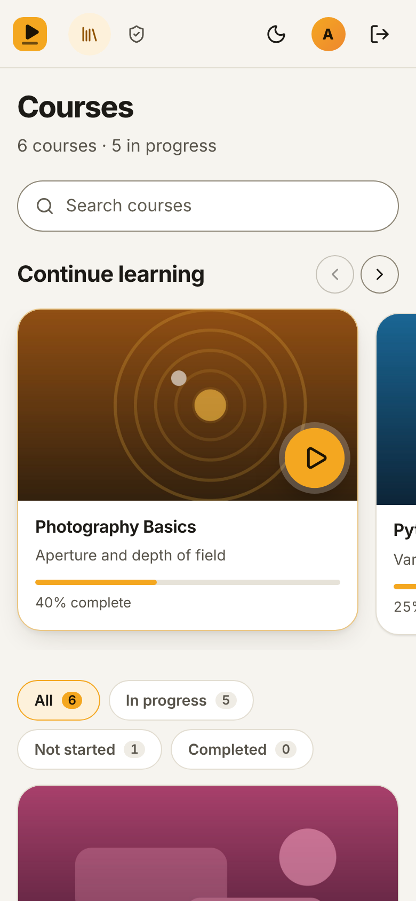
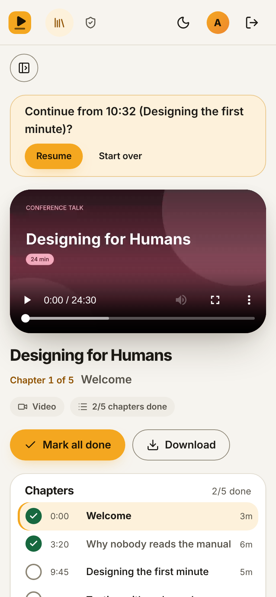

# Lectern

**Your own course library, on your own server.** Put your course videos, PDFs
and notes in folders, point Lectern at them, and everyone at home or on your
team gets a clean course player: sections, a "continue where you left off"
button, and progress remembered for each person. Free and open source, and it
sends nothing to anyone.

[](https://github.com/Rimkomatic/lectern/actions/workflows/ci.yml)
[](https://github.com/Rimkomatic/lectern/releases)
[](LICENSE)

<p align="center">
  
  
</p>
<p align="center">
  
  
  
</p>
<p align="center"><sub>The courses in these pictures are made up. <code>make screenshots</code> rebuilds them.</sub></p>

Lectern is for **files you already have**: your own recordings, conference
talks, open courseware, training material you made or may keep. It does not
download, sell or unlock anything (see "Questions" below).

## What you get

- **A course player for a folder.** A folder is a course, its sub-folders are
  sections and its files are the lessons. There is no import step: add a folder
  and it shows up after the next scan ("Library layout" has the details).
- **Progress for each person.** Lectern resumes at the exact second or PDF page,
  ticks off lessons, shows percentages and keeps a "Continue learning" row.
  Everyone has their own account, so a family or a team can share one library.
- **Plays what browsers play.** Video and audio, PDFs, images, Markdown and web
  pages, text and code, with subtitles (`.srt`, `.vtt`) and chapters for long
  videos. Anything else is listed with a download button, and every file can be
  downloaded. Files are streamed as they are, with no transcoding, so it asks
  little of the server.
- **Works on a phone.** The layout adapts to small screens, there are light and
  dark themes, and it can sit on your home screen like an app (see "On a
  phone").
- **Private.** No account with anyone but you, no analytics, no update check:
  the server makes no connection to the internet, and the web app loads nothing
  from other sites. Accounts are made by an administrator (there is no open
  sign-up), and your library is mounted read-only, so Lectern cannot change your
  files.
- **Easy to run.** One small Go program with the web app inside, plus MySQL,
  started by one compose file that pulls a prebuilt image (amd64 and arm64).

Lectern is young (0.x). What is described here works and is tested, but expect
rough edges, and please open an issue when you meet one. "Not done yet", near
the end, lists what is missing.

## Quick start (Docker)

You need Docker with the compose plugin (`docker compose version` should print
a version). Nothing else, and nothing to build: the app image is published on
GitHub's container registry for amd64 and arm64 (PCs and servers, a Raspberry Pi
with a 64-bit system, Apple silicon), and the database is the official MySQL
image.

1. Make a folder for it and download the compose file and the settings template
   into it:

   ```sh
   mkdir lectern && cd lectern
   curl -fsSLO https://github.com/Rimkomatic/lectern/releases/latest/download/docker-compose.yml
   curl -fsSL https://github.com/Rimkomatic/lectern/releases/latest/download/env.example -o .env
   ```

2. Edit `.env`. Set at least:
   - `MYSQL_ROOT_PASSWORD` and `MYSQL_PASSWORD`: choose your own, before the
     first start (MySQL keeps the password it was created with);
   - `LECTERN_LIBRARY`: the folder with your courses, on this machine. Every
     folder in it becomes a course. It is mounted read-only;
   - `PUID` and `PGID`: the output of `id -u` and `id -g` (1000 and 1000 on
     most single-user Linux machines), so the app may read your files;
   - `LECTERN_PORT` if 8080 is taken.
3. Start both containers: `docker compose up -d`. The first start pulls the
   images, which takes a minute or two.
4. Open `http://localhost:8080` (or `http://<the machine>:8080` from another
   device). The first visit asks you to create the administrator account. Do
   that right away: until you do, anyone who can reach the page can. For safety
   the page closes 15 minutes after Lectern starts, and opens again when
   Lectern is restarted (`docker compose restart app`); `LECTERN_SETUP_WINDOW`
   changes the time. Or set `LECTERN_ADMIN_USER` and `LECTERN_ADMIN_PASSWORD`
   in `.env` to have the account created at start-up.

Courses appear after the first scan, which runs at start-up. After that the
library is scanned once a day, at 03:00 (set `TZ` in `.env` to your time zone;
see Settings). A course you add later shows up after that scan, or at once with
Admin → Scan now. Create accounts for the other people under Admin → Users.

### Day to day

```sh
docker compose ps                  # both containers should be up, the app "healthy"
docker compose logs -f app         # what the app is doing: scans, errors
docker compose up -d               # after editing .env: recreates what changed
docker compose pull                # fetch the newest image (see "Updating")
docker compose down                # stop and remove the containers; the data stays
```

The accounts, progress and uploaded covers live in the MySQL volume
`lectern-mysql`, so `down` keeps them; **`docker compose down -v` deletes
them**. Your course files are never written to. To back up the database:

```sh
docker compose exec -T mysql sh -c 'MYSQL_PWD="$MYSQL_PASSWORD" mysqldump -u"$MYSQL_USER" --no-tablespaces --single-transaction "$MYSQL_DATABASE"' > lectern-backup.sql
```

and to restore it into an empty database:

```sh
docker compose exec -T mysql sh -c 'MYSQL_PWD="$MYSQL_PASSWORD" mysql -u"$MYSQL_USER" "$MYSQL_DATABASE"' < lectern-backup.sql
```

### Updating

```sh
docker compose pull && docker compose up -d
```

`LECTERN_TAG` in `.env` decides what "newest" means:

| `LECTERN_TAG` | You get |
|---|---|
| `latest` (the default) | the newest release |
| `1.2.3` | exactly that release |
| `1.2` or `1` | the newest release inside 1.2.x or 1.x |
| `edge` | the newest commit on the main branch; it can break |

What changed is on the
[Releases](https://github.com/Rimkomatic/lectern/releases) page and in
`CHANGELOG.md`. A new version may change the database layout when it starts,
and the changes only go forward, so take the backup above first and note the tag
you were on. An older version will not start on a database that a newer one
has upgraded (the log says "this database was upgraded by a newer version of
Lectern") rather than risk damaging it: run the newer version again, or restore
the backup you took before updating.

### On a phone

Open Lectern in the phone's browser. The layout adapts, and the course outline
becomes a drawer. To put it on the home screen so it opens like an app:

- **iPhone and iPad (Safari):** Share, then *Add to Home Screen*.
- **Android (Chrome):** the menu, then *Install app* or *Add to Home screen*.
  Chrome installs it as an app only when the site is served over HTTPS (see
  "Behind a reverse proxy"); over plain `http://` you get a shortcut that opens
  in the browser.

It still needs your server: there is no offline mode.

### Forgot a password?

An administrator can reset any password from the server. The command prints a
new random password once, and signs that person out on every device:

```sh
docker compose exec app lectern -reset-password alex
```

`alex` is the username (capitals do not matter; if the name is wrong, the
command lists the accounts that exist). Give the person the new password; they
can change it under Settings. To choose the password yourself, send it in on
standard input (at least 8 characters):

```sh
echo 'a new long password' | docker compose exec -T app lectern -reset-password alex -password-stdin
```

Anyone who can run commands on the server can do this, so protect the server
itself. After 8 wrong passwords within 15 minutes, for one account or from one
address, further logins are refused until the 15 minutes are over; `docker
compose restart app` clears that at once.

### Changing the setup

- **Ports, passwords, paths, user:** everything is in `.env`; the compose file
  lists which settings the app container receives. `LECTERN_PORT` only changes
  the port on the machine; inside the container the app always listens on
  8080. Behind a reverse proxy on the same machine, publish it on the loopback
  only: change the port line to `"127.0.0.1:${LECTERN_PORT:-8080}:8080"`.
- **More than one course folder:** add a volume for each (copy the
  `/library` one, mount it at `/library2`) and list them in the app's
  environment: `LECTERN_LIBRARIES: "/library;/library2"`, or with labels,
  `"Work=/library;Home=/library2"`.
- **Your own MySQL instead of the container:** create an empty database and a
  user for it (`utf8mb4`, MySQL 8 or newer), delete the `mysql` service, the
  `depends_on` block and the `lectern-mysql` volume from the compose file, and
  set `MYSQL_HOST` (and `MYSQL_PORT`) in the app's environment to your server.
  For TLS or other driver options use `LECTERN_DB_DSN`.
- **SELinux (Fedora, RHEL):** add `selinux: z` under `bind:` in the library
  volume, otherwise the container cannot read the mounted folder.
- **Build the image yourself** instead of pulling it, from a clone of this
  repository:
  `docker compose -f docker-compose.yml -f docker-compose.build.yml up -d --build`
  (`make image` builds the image alone, tagged `lectern:local`).
- **Docker Hub instead of GitHub's registry:** the same image is also published
  as `rimkomatic/lectern`. Change the `image:` line of the compose file to
  `rimkomatic/lectern:${LECTERN_TAG:-latest}`.
- **The image on its own** (`ghcr.io/rimkomatic/lectern`): it runs as user 10001
  unless you pass `--user`, listens on 8080, reads `/library`, has a health
  check (`lectern -healthcheck`) and takes all the `MYSQL_*` and `LECTERN_*`
  settings as environment variables. `docker run --rm
  ghcr.io/rimkomatic/lectern -version` prints its version.

### If something is wrong

- **`bind source path does not exist`:** `LECTERN_LIBRARY` points to a folder
  that is not there. It is a path on the machine that runs Docker.
- **Empty library, and `permission denied` in `docker compose logs app`:** the
  app user cannot read your files. Set `PUID` and `PGID` to the owner of the
  folder (`ls -ln` shows the numbers), then `docker compose up -d`. To look
  from inside: `docker compose exec app ls -ln /library`.
- **`Access denied for user` in the log:** the password in `.env` is not the one
  MySQL was created with. Put the old one back, or change it inside MySQL
  (`ALTER USER`), or, if there is nothing to lose yet, `docker compose down -v`
  and start again.
- **`port is already allocated`:** something else uses the port (an app started
  with `make run`, for example). Stop it or change `LECTERN_PORT`.
- **Logging in answers "cross-site request blocked":** see "Behind a reverse
  proxy" below.

## Questions

**Where do the courses come from?** From you. Lectern only plays files that are
already on your disk: your own recordings, conference talks, open courseware,
training material you made or are allowed to keep. It has no catalogue and
does not download, sell or unlock anything. Please respect the licences of the
courses you put in it.

**Will it play my files?** Your browser does the playing, so whatever it can
play works: MP4 (H.264 and AAC), WebM, MP3, M4A and the like. Some containers
and codecs (MKV, AVI, H.265) work in one browser and not in another. A file the
browser cannot play is offered as a download, and a lossless copy into MP4 often
fixes it: `ffmpeg -i lesson.mkv -c copy lesson.mp4` when the codecs are
H.264 and AAC.

**Can I use it away from home?** It is built for a home or office network. To
reach it from the internet, put it behind a reverse proxy that serves HTTPS
(see "Behind a reverse proxy"), choose long passwords and keep it updated.
There is no sign-up form, wrong passwords are rate limited, and MySQL is not
published on any port. `SECURITY.md` has the rest.

**Does it send anything anywhere?** No. There is no analytics, no update check
and no account with the project. The server talks only to its own database, and
the web app loads nothing from other sites.

**How many people can use it?** As many as you create accounts for. It is meant
for a household, a class or a small team; each person's progress is separate.

## Library layout

```
/path/to/courses/                  a library (LECTERN_LIBRARY in Docker)
├── Python for Beginners/          a course: the folder name is its title
│   ├── cover.jpg                  optional cover picture
│   ├── course.json                optional: {"title": "…", "description": "…", "order": 1}
│   ├── Syllabus.pdf               loose files form a "Course files" section, shown first
│   ├── 01 - Getting started/      a section: the folder name is its title
│   │   ├── 01 - Welcome.mp4
│   │   ├── 01 - Welcome.en.srt    subtitles, matched by file name
│   │   ├── 02 - Install Python.mp4
│   │   ├── 03 - Cheat sheet.pdf
│   │   └── 04 - Documentation.url a link to a web page
│   └── 02 - Variables/
│       └── …
├── Quick tips/                    a folder with only videos is fine: no sections needed
│   ├── 01 - Tip one.mp4
│   └── 02 - Tip two.mp4
├── Conference talk.mp4            a video in the library root is a course of its own
├── Conference talk.chapters.txt   optional: chapters of that video (see below)
├── Conference talk.jpg            optional: its cover picture
└── Another course/
```

- A folder directly inside a library is a course, a folder inside a course is a
  section. Deeper folders are flattened into their section ("Part 1 / Lesson").
- A course folder that holds only files and no section folders is shown as a
  plain list, without any section heading.
- A video or audio file placed directly in the library root is a course of its
  own, titled after the file, with its own progress. Subtitles, chapters and a
  cover picture with the same name sit beside it (`Talk.en.srt`,
  `Talk.chapters.txt`, `Talk.jpg` or `Talk-poster.jpg`). Other files in the
  root are ignored. Renaming such a file, or moving it into a folder, keeps
  its progress.
- Items sort naturally (2 before 10). Course titles are the folder name as it
  is. Section and file titles drop ordering prefixes such as `01 - `,
  `Section 2: ` or `[03]`, but still sort by them.
- A cover is a `cover`, `poster`, `folder`, `thumbnail` or `thumb` image
  (jpg, png, webp or avif) in the course folder. An admin can also pick one in
  the browser: **Change cover** on the course page (see "Look and feel").
- Links are `.url` (Windows), `.webloc` (macOS) or `.desktop` (Linux) files that
  hold an http or https address.
- Subtitles are `.srt` or `.vtt` files in the same folder as the video, named
  after it and optionally followed by a language: `Welcome.en.srt`,
  `Welcome.English.srt`, `Welcome.pt-BR.forced.srt`, `Welcome (Spanish).srt`.
  Words such as `subs`, `CC` or `SDH` are ignored. UTF-8 and UTF-16 files both
  work. When a folder holds a single video, a subtitle named only for its
  language (`English.srt`, `subtitles.srt`) goes with it. A subtitle that
  matches no video is not shown as a lesson; Admin → Library scan lists it, so
  you can rename it. (In a folder with no video at all it stays a text lesson.)
- In the player, **C** switches captions on and off, and the player remembers
  your choice on that device, so the next lesson starts the same way.
- What the player shows: video and audio play, PDFs render page by page,
  images, Markdown, HTML pages, text, code and CSV display. Spreadsheets (xlsx,
  ods, …), Office files, archives and everything else are listed with a
  download button.
- Markdown (`.md`) and HTML (`.html`, `.htm`, and `.txt` files that were saved
  from a web page) are shown formatted, with a **Source** switch. They are
  cleaned first: scripts, styles, forms, frames and the page's own ids and
  classes are removed, and links open in a new tab. Pictures stored in the
  course beside the page (`images/diagram.png`) are shown. Pictures hosted on
  other web sites are never loaded; a note says how many were left out. Links
  to other pages of the course are not followed. Files in UTF-8, UTF-16 or
  Windows-1252 (and the encoding an HTML page declares) are read correctly.
- Hidden files, `Thumbs.db`, `@eaDir`, half-downloaded files (`.part`,
  `.crdownload`, …) and similar clutter are skipped.
- Symbolic links are followed only when they stay inside the library, unless
  `LECTERN_FOLLOW_SYMLINKS=true`.
- The library is only ever read. Mounting it read-only is fine. (Covers that
  an admin uploads are kept in the database, not written to the library.)

## Chapters for long videos

For a single long video you can add a text file with its topics. Lectern lists
them as chapters, jumps to the one you click, and tracks progress per chapter.
Name the file after the video with `.chapters.txt` (or `.timestamps.txt`):
`Lecture.mp4` goes with `Lecture.chapters.txt`.

```
0:00 Introduction
12:30 Setting up the project
1:02:15 Wrap-up
```

- One chapter per line: a time (`M:SS` or `H:MM:SS`), then the title. The way
  chapters are written in a YouTube description works as it is. Brackets,
  dashes, colons, bullets and list numbers around the time are fine
  (`[12:30] - Setting up`, `1. 0:00 Intro`). Lines without a time are
  ignored, the order does not matter, and two chapters in the same second keep
  the first. Up to 1000 chapters, titles are cut at 200 characters. A file
  with no usable line is shown as an ordinary text file.
- Chapters are listed under the video on the course page and in the sidebar,
  and under the player when the sidebar is closed. Clicking one jumps to it
  and plays. The player shows which chapter is on, and "continue where you left
  off" names it.
- **Progress follows the chapters.** Each chapter counts as one lesson in the
  numbers and the percentage. A chapter is finished when playback runs through
  its end (skipping a few seconds forward with the arrow keys over the end
  counts, dragging the bar or clicking a chapter further on does not), the last
  one when the video plays to its end, or by hand with the tick beside it. The
  video is done once every chapter is. Playing to the very end does not finish
  chapters you skipped. **Mark done** on the video finishes all its chapters,
  **Mark not done** clears them.
- You can edit the file at any time. After the next scan a chapter keeps its
  tick as long as its start time, in whole seconds, stays the same. Deleting
  the file makes it an ordinary video again (one that was finished stays
  finished). A video that was already finished when you add chapters has all of
  them finished.

## Progress and resuming

- **Video and audio:** the position is saved every 10 seconds while playing and
  when you pause, seek or leave. An item is done when it plays to the end or
  past 95% (`LECTERN_DONE_THRESHOLD`). Videos with chapters are the exception,
  see above.
- **PDF:** the page is saved as you read, done on the last page.
- **Everything else** (images, text, links, downloads): done when opened. Each
  person can turn that off in Settings.
- Anyone can mark an item done or not done by hand from the course outline.
- A course shows its percentage complete, and the home page has a "Continue
  learning" row. Opening a course offers to continue where you left off, at
  the exact second or page. After a finished item it offers the next one. In
  Settings each person picks whether to be asked (the default), to continue
  automatically, or to always start from the beginning.
- Autoplay of the next video (with a 5 second countdown) and the playback speed
  are per-person settings too.
- **Dropping a course.** On a course page, "Drop course" (with a Yes/No
  question first) deletes your progress in that course: every item's state,
  ticked chapters, and the place to continue from. It then shows as not started
  and leaves "Continue learning". Nothing else changes: the course and its files
  stay in the library, other people's progress is untouched, and there is no
  undo. The button only appears when you have something recorded there. If you
  start the course again, it starts from nothing.
- Renaming a course folder, or renaming or moving a file, keeps its progress.
  Files that disappear keep theirs for 30 days (`LECTERN_MISSING_RETENTION`) in
  case a drive was just unmounted, and an empty or unmounted library never
  wipes anything.

## Look and feel

- **Home is a gallery.** Courses are cards with their cover picture (see
  "Library layout" for what counts as one), or drawn artwork with the course's
  initials when there is none. A "Continue learning" row sits on top; filters
  (all, in progress, not started, completed) and search sit above the gallery.
- **The lesson page has a course-content sidebar** on the left:
  sections fold open and shut, every lesson shows its progress (done, started,
  not started), and the lesson on screen is highlighted. The button above the
  lesson collapses it; the choice is remembered on that device. On a phone or a
  narrow window it becomes a drawer (Escape or a tap outside closes it).
- **Keyboard on the video and audio player.** These work wherever the focus is
  on the lesson page: **Space** plays and pauses, **←** and **→** skip 5
  seconds back and forward, **↑** and **↓** change the volume by 5%. A small
  pill on the picture confirms each press. Text fields and widgets that use
  those keys themselves (sliders, menus) keep them, and so does a button you
  reached with Tab (Space presses it); after clicking a button with the mouse,
  Space plays and pauses again. The keys step aside while the phone drawer is
  open. The volume is remembered on that device (`localStorage`, key
  `lectern-volume`), so the next lesson starts at the level you chose.
- **Course covers.** On a course page an admin sees **Change cover** over the
  picture (and, once one is uploaded, a small bin to remove it). JPEG, PNG,
  WebP or AVIF, at most 5 MB; the browser shrinks anything larger than
  1600 x 1000 pixels (or 1.5 MB) before sending it. The picture is stored in
  MySQL (table `course_covers`), shows to everyone, and wins over a `cover`
  image in the folder; removing it brings the folder image (or the drawn
  artwork) back. It belongs to the course entry: it follows the course when
  the folder is renamed (as far as progress does) and is dropped with it once
  the folder has been gone past the retention period. Over the API: `PUT` or
  `DELETE` `/api/v1/admin/courses/{id}/cover` (admins only; `PUT` takes the raw
  image as the request body).
- **Light and dark.** The sun/moon button in the top bar flips the theme.
  Settings → Appearance also offers "System", which follows the device. The
  choice is stored in the browser (`localStorage`, key `lectern-theme`), not in
  the account, so a phone and a desktop can differ.
- **The app loads nothing from the internet** (the server's content security
  policy only allows its own origin). The Inter font (a 48 kB Latin
  subset, SIL Open Font License) and the icons (from Lucide, ISC licence) are
  part of the build; their licence texts are in `web/src/assets/`.
- **Changing the colours.** Every colour, radius and size is a CSS variable in
  `web/src/styles/tokens.css`: one block for light, one for dark. The shipped
  palette is warm paper and ink with an amber accent. After editing, run
  `npm run contrast` in `web/` to check that text stays legible (WCAG AA);
  `make test` runs it as well.

## Settings

The app is configured with environment variables, or a `.env` file in the
folder it starts in (real environment variables win). In Docker you only edit
`.env`: `docker compose` reads it and hands the settings listed in
`docker-compose.yml` to the app container. The ones you are likely to need:

| Variable | Default | |
|---|---|---|
| `MYSQL_HOST`, `MYSQL_PORT` | `127.0.0.1`, `3306` | where MySQL is (the compose file sets `mysql`, `3306`) |
| `MYSQL_DATABASE`, `MYSQL_USER` | `lectern`, `lectern` | |
| `MYSQL_PASSWORD` | required | |
| `LECTERN_LIBRARIES` | `/library` | folders to scan, separated by `;`, each with an optional label: `Work=/mnt/a;/mnt/b` |
| `LECTERN_LISTEN` | `:8080` | address to listen on |
| `LECTERN_SCAN_AT` | `03:00` | time of the daily automatic scan, 24-hour `HH:MM`; `off` turns automatic scans off (the start-up scan and Scan now stay) |
| `LECTERN_SCAN_INTERVAL` | | scan every so often instead of daily (`30m`, `6h`); use this or `LECTERN_SCAN_AT`, not both |
| `TZ` | UTC | your time zone, for example `Europe/Berlin`; the daily scan runs at `LECTERN_SCAN_AT` in this zone. Docker: set it in `.env`. Without Docker the machine's own time zone is used |
| `LECTERN_TRUST_PROXY` | `false` | set to `true` behind a reverse proxy, see below |
| `LECTERN_SETUP_WINDOW` | `15m` | how long after start-up the setup page may create the first administrator (`30m`, `2h`, `1d`; `forever` removes the limit). Afterwards it stays closed until Lectern is restarted. It only matters while nobody has an account |

Read by `docker compose` only, not by the app:

| Variable | Default | |
|---|---|---|
| `LECTERN_LIBRARY` | `./library` | folder with your courses, mounted read-only at `/library` |
| `LECTERN_PORT` | `8080` | port the site answers on |
| `LECTERN_TAG` | `latest` | which version of the image to run, see "Updating" |
| `PUID`, `PGID` | `1000`, `1000` | user and group the app runs as; they must be able to read the library |
| `MYSQL_ROOT_PASSWORD` | required | for the MySQL container itself |

`.env.example` lists every setting with a short explanation. The same
`MYSQL_*` names are used by both containers, so the database settings are
written once.

## Behind a reverse proxy

Serve it over HTTPS if it is reachable from outside your home network. The
server checks that logins and other changes come from its own address: it
compares the browser's `Origin` header with the `Host` header it receives.
So the proxy has to:

- pass the original `Host` header on (nginx: `proxy_set_header Host $host;`),
  or send `X-Forwarded-Host` and run with `LECTERN_TRUST_PROXY=true`;
- send `X-Forwarded-Proto: https` and `X-Forwarded-For`, and the server has to
  run with `LECTERN_TRUST_PROXY=true`, so the login cookie is marked Secure and
  the login rate limit sees the real client address.

If logging in answers "cross-site request blocked", this is the cause. Another
way out is to list the public address in `LECTERN_ALLOWED_ORIGINS`
(`https://courses.example.com`).

Course covers are uploaded through the proxy and can be up to 5 MB, so a proxy
that limits the size of a request needs room for that (nginx:
`client_max_body_size 6m;`, its default is 1 MB).

## Development

Bug reports, ideas and pull requests are welcome: see `CONTRIBUTING.md`.

### Run from source

You need Go 1.24+, Node 22.13+ and Docker (for MySQL; any MySQL 8 you can reach
works too).

```sh
cp .env.example .env     # passwords as above; uncomment LECTERN_LIBRARIES at the bottom
make setup               # once: go mod tidy + npm ci
make db                  # only MySQL, on 127.0.0.1:3306, waits until it is ready
make run                 # builds the web app and the server, then starts it
```

Open <http://localhost:8080>. `make db` starts the same MySQL container and
data volume as the Docker setup, so do not run both apps at once.

`make setup` runs once: it fetches the Go and npm dependencies (`go mod tidy`
keeps `go.mod` and `go.sum` in step; commit them if they change).

Without `make`:

```sh
go mod tidy && (cd web && npm ci)
docker compose -f docker-compose.yml -f docker-compose.dev.yml up -d --wait mysql
(cd web && npm run build)
go run ./cmd/lectern     # reads .env from the current folder
```

`make help` lists the other targets.

For the web app with hot reload, start the server as above and, in another
terminal, `cd web && npm run dev`: it serves on :5173 and proxies to :8080.

### Tests

```sh
make db db-test         # once: MySQL, plus an empty lectern_test database
make test               # gofmt, go vet, Go tests, svelte-check, web tests
make e2e                # browser smoke test, see below
```

- The Go tests that need MySQL use `lectern_test` (user and password
  `lectern_test`, created by `make db db-test`). Override with
  `LECTERN_TEST_DB_HOST`, `_PORT`, `_NAME`, `_USER` and `_PASSWORD`. Every test
  empties that database, so the test helper refuses any database whose name does
  not contain "test".
- Plain `go test ./...` skips the database tests when MySQL cannot be reached.
  `make test` (which sets `LECTERN_TEST_REQUIRE_DB=1`) fails instead. Run
  packages one at a time with `-p 1`, as the Makefile does, because they share
  one database.
- `make e2e` (`e2e/run.sh`) builds everything, empties the test database, makes
  a small sample library and drives the interface with headless Chrome: setup,
  login, video playback and resume, PDF, Markdown, tables, images, links,
  downloads, settings, administration, a second user, the course-content
  sidebar, the theme switch, the phone drawer, the player's keyboard shortcuts,
  cover uploads, folders of only videos, single-video courses and chapters
  (some 300 checks). It needs ffmpeg, Python 3 with
  `pip install playwright pillow reportlab`, and Chrome or Chromium
  (`E2E_CHROME=/path/to/chrome`, or `playwright install chromium`).
- `make screenshots` retakes the pictures at the top of this file from a
  made-up demo library (`e2e/make_demo_library.py`), with the same tools as
  `make e2e`. It empties the test database too.

GitHub Actions (`.github/workflows/`) runs all of this on every pull request,
plus a check that the Docker setup really starts and a build for amd64 and
arm64. How releases are made: `RELEASING.md`.

Layout:

```
Dockerfile                the app image: builds the web app and the server, then a small runtime
docker-compose.yml        the app (pulled from ghcr.io) + MySQL, configured from .env
docker-compose.build.yml  builds the app image from this source instead of pulling it
docker-compose.dev.yml    adds MySQL on 127.0.0.1 for development (make db)
.env.example              every setting; copy it to .env
.github/                  ci.yml (tests) and release.yml (publishes the image), issue forms, Dependabot
LICENSE, THIRD-PARTY-NOTICES.md, SECURITY.md, RELEASING.md, CHANGELOG.md, CONTRIBUTING.md
docs/screenshots/         the pictures at the top of this file (make screenshots)

cmd/lectern        entry point (flags: -version, -healthcheck, -reset-password)
internal/accounts  resetting a password from the command line
internal/api       HTTP API, sessions and CSRF checks, file streaming, scan events
internal/auth      password hashing, session tokens, login rate limiting
internal/config    environment and .env loading
internal/db        connection and embedded SQL migrations
internal/fsutil    keeps file access inside the library folders
internal/scan      folder walker, naming rules, duration probing
internal/store     all the SQL: users, sessions, courses, progress, settings
internal/webui     the built web app, embedded in the binary
internal/testdb    throw-away database for tests
web/               Svelte 5 + Vite + TypeScript source of the web app
web/public         manifest, icons and robots.txt, copied as they are into the build
web/src/styles     design tokens (colours, shapes), base and shared component CSS
web/scripts        check-contrast.mjs (`npm run contrast`), the home-screen icon generator
e2e/               browser test (run.sh), a check of the Docker setup (compose-smoke.sh), screenshots
docker/            SQL that creates the test database
```

## Database

MySQL 8. Developed and tested on 8.0; `docker-compose.yml` runs 8.4 LTS in its
own container with settings that keep it small (no binary log, no performance
schema, a 128 MB buffer pool). The container is not published on any port:
only the app container reaches it, over Docker's network. The SQL sticks to
features MariaDB shares, but MariaDB has not been tried. Migrations are
embedded in the binary and applied at start-up, under a lock, so two servers
starting together are safe.

MySQL is a separate process, so the footprint is bigger than a single binary
with an embedded database would be. Only `internal/db` and `internal/store`
talk to the database, which keeps another backend possible later.

The compose file keeps the data in the volume `lectern-mysql`.
`docker compose down` removes the containers and keeps the data;
`docker compose down -v` deletes it.

## Not done yet

No offline mode (Lectern can sit on a phone's home screen, but it needs your
server), no full-text search, no single sign-on (OIDC or proxy headers), no
"download the whole course" zip, no file-system watcher (scans run once a night
and on request), no in-browser preview of spreadsheets, no translations,
argon2id instead of the current PBKDF2-HMAC-SHA256 (600,000 rounds) for
passwords, no way to edit course details in the interface (use `course.json`),
HTML pages show without their own styling, scripts or links to other files of
the course, subtitles must sit in the same folder as their video, and chapters
embedded in the video file itself (MP4 or MKV) or in YouTube `.info.json` files
are not read, only `.chapters.txt`.

**Tested with** Chrome on Linux (the browser test in `e2e/` runs in CI) and
MySQL 8. Firefox, Safari, the arm64 image on real hardware and MariaDB have not
been tried by hand yet; reports are welcome.

## License

MIT, see `LICENSE`.

Lectern is an independent project. It is not affiliated with or endorsed by
Jellyfin or by any course platform, and other names belong to their owners.

The third-party software in the web app and the server (Svelte, marked,
DOMPurify, PDF.js, the Inter typeface, the Lucide icons, the Go MySQL driver)
keeps its own licences. They are listed in `THIRD-PARTY-NOTICES.md`, which is
also in the image, under `/usr/share/licenses/lectern/`. The licence texts of
the font and the icons are in `web/src/assets/` too.
